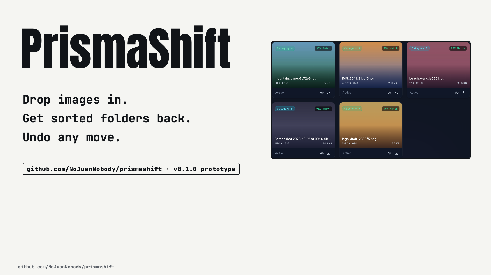

# 💠 PrismaShift

**PrismaShift is a self-hosted image sorter for a home server: someone drops images on a web page, each one is filed into a folder by what kind of image it is (camera photo, screenshot, wide, tall or square), and an admin can see every move and undo it.** It is an early prototype (v0.1.0).

[](https://nojuannobody.github.io/prismashift/explainer/explainer.mp4)

[▶ Watch the 60-second explainer](https://nojuannobody.github.io/prismashift/explainer/explainer.mp4) · [Read the one-page explainer](https://nojuannobody.github.io/prismashift/explainer/)

### How it works for you

1. **Open the dashboard** in a browser and drag images onto the drop zone (JPG, PNG, WEBP, GIF, BMP, TIFF, HEIC, AVIF).
2. **The server checks each file in order** and stops at the first match: a file name that says "screenshot" → `screenshots/`; camera maker or model in the EXIF tags → `photos/`; otherwise the shape → `landscape/`, `portrait/` or `square/`.
3. **The file moves into that folder**, and the page marks it Type A (photos, landscape) or Type B (screenshots, portrait, square) and shows it in the gallery.
4. **Every move is logged** in SQLite: old path, new path, SHA-256 and the rule that matched.
5. **The admin can undo it**: `prismashift-admin history` lists moves, `prismashift-admin rollback <id>` puts a file back.

> **Status (checked on commit b5229f9):** browser upload, sorting, history and rollback work. The folder watcher is written but not started by the server, so files copied into the inbox folder wait for `prismashift-admin scan`. The Docker Compose setup currently crashes on start (see Quickstart).

---

> **Intelligent, Automated Homelab Image Sorting Toolchain**  
> Complete with a zero-friction Customer Web Dashboard and an Admin CLI with instant rollback.

---

## 🌟 Why PrismaShift?

When hosting automated file workflows for clients on your homelab:
1. **End users / Customers** want simplicity: drag & drop into a browser or paste into a mapped folder (folder drops are picked up by `prismashift-admin scan`; the automatic watcher is not wired in yet). They should never touch terminals, configs, or risk losing photos.
2. **Admins / Maintainers** need deep visibility: preview rules with dry-runs, monitor network ingestion debouncing, inspect transaction logs, and roll back any operation with a single command.

PrismaShift is engineered in Python with a watchdog-based folder watcher (implemented, not yet started by the server) and a SQLite transaction ledger. Zero JVM overhead, instant startup, low memory footprint (~40MB RAM).

---

## 🏗️ Architecture

```
[ Customer / Camera / Dropzone ]
               │
               ▼
   📥 /data/inbox (Watched Folder)
               │
               ▼
┌───────────────────────────────────────────────┐
│ 1. Debounced Ingestion Worker                 │
│    - Stabilizes file writes (SMB/NFS safe)    │
└──────────────────────┬────────────────────────┘
                       │
                       ▼
┌───────────────────────────────────────────────┐
│ 2. Extensible Classifier                      │
│    - Aspect Ratio (Landscape vs Portrait)     │
│    - EXIF Camera Tag (Camera vs Screenshot)   │
│    - Resolution / Dimension Thresholds        │
└──────────────────────┬────────────────────────┘
                       │
        ┌──────────────┴──────────────┐
        ▼                             ▼
  📂 sorted/photos, landscape    📂 sorted/screenshots, portrait, square
     (shown as Type A)              (shown as Type B)
        │                             │
        └──────────────┬──────────────┘
                       │
                       ▼
┌───────────────────────────────────────────────┐
│ 3. Atomic SQLite Ledger                       │
│    - SHA-256 hashes, paths, timestamps       │
│    - 1-click batch rollback                   │
└───────────────────────────────────────────────┘
```

---

## 🚀 Quickstart (Homelab Docker)

```bash
# Clone the repository
git clone https://github.com/NoJuanNobody/prismashift.git
cd prismashift

# Spin up with Docker Compose
docker compose up -d
```

Open `http://localhost:8080` to access the customer web dashboard!

> **Known issue (v0.1.0):** as shipped, the compose file mounts `./data/db` as a directory at `/data/prismashift.db`, so the server exits with `sqlite3.OperationalError: unable to open database file`. Also, the code reads `PRISMASHIFT_DEST_DIR`, while the Dockerfile and compose set `PRISMASHIFT_ORGANIZED_DIR`, so sorted files land in `/app/organized` inside the container. Until those are fixed, run it with Python:
>
> ```bash
> pip install fastapi uvicorn watchdog pillow pydantic python-multipart
> export PRISMASHIFT_INBOX_DIR=./data/inbox PRISMASHIFT_DEST_DIR=./data/sorted
> uvicorn src.api:app --port 8080
> ```

---

## 💻 Admin CLI (`prismashift-admin`)

Maintainers can interact via SSH or `docker exec`:

### Check System Status
```bash
$ ./prismashift-admin status
```

### Dry-Run Rule Testing
Preview how incoming files would be classified without touching disk:
```bash
$ ./prismashift-admin test-rules --sample 20
```

### Batch Scan Inbox
```bash
$ ./prismashift-admin scan
$ ./prismashift-admin scan --dry-run
```

### Transaction History & 1-Click Rollback
```bash
# View recent transaction batches
$ ./prismashift-admin history --limit 10

# Roll back any transaction by ID or UUID
$ ./prismashift-admin rollback <TX_ID_OR_UUID>
```

### Reprocess Files
```bash
$ ./prismashift-admin reprocess --unclassified-only
```

---

## 🌐 Customer Web Interface

- **Drag-and-Drop Ingestion Zone:** Direct browser upload with instant classification telemetry.
- **Categorized Galleries:** Filter by Type A, Type B, or Unclassified with resolution and the matched rule's confidence (a fixed number per rule, not a model score).
- **Instant ZIP Download:** One-click download of sorted images as a ZIP (works from the "All" tab; the Category A/B tabs currently return 404).
- **Activity Stream:** Recent moves, refreshed after each upload; the total count updates every 2 seconds.

---

## 🛠️ Configuration Options

Configured via environment variables or `.env`:

| Variable | Default | Description |
| :--- | :--- | :--- |
| `PRISMASHIFT_INBOX_DIR` | `./inbox` | Watched directory for incoming files |
| `PRISMASHIFT_DEST_DIR` | `./organized` | Destination directory for sorted categories (the Dockerfile and compose file still set `PRISMASHIFT_ORGANIZED_DIR`, which the code does not read) |
| `PRISMASHIFT_DB_PATH` | `./prismashift.db` | SQLite transaction ledger file |
| `PRISMASHIFT_DEBOUNCE_SECONDS` | `1.5` | Settle time for network file transfers |
| `PRISMASHIFT_ROUTE_MODE` | `MOVE` | `MOVE`, `COPY`, or `SYMLINK` |

---

## 🧪 Testing

Run test suite:
```bash
pytest tests/
```
